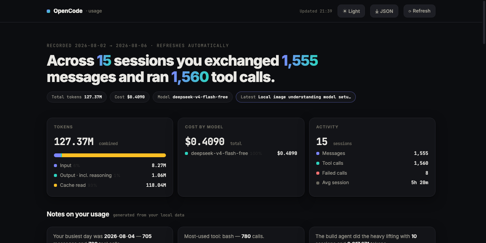

# OpenCode Dashboard

[](LICENSE)
[]()
[]()
[](https://github.com/touchkale/opencode-dashboard)

> A live usage dashboard for [OpenCode](https://github.com/anomalyco/opencode), served by a single Python file — no framework, no build step, no dependencies.



- **Single file**: `opencode_dashboard.py` is the whole server and page.
- **Token-first**: every chart, bar and heatmap shows tokens used — Input vs Output (incl. reasoning) vs Cache — with day-vs-day and model-vs-model comparisons.
- **Four tabs**: **OpenCode** (local SQLite), **Codex** (router `usage-events.jsonl`), **Cline** (Desktop app `~/.cline/data` sessions, same KPIs as Codex), and **Recap** — a recording-friendly daily total across all harnesses with per-harness split, providers, and top conversations for your YT Shorts.
- **Harness toggles**: the ⚙ Harnesses menu lets you disable any harness you are not using — its tab hides and Recap excludes it (persisted in `localStorage`).
- **Auto-refreshing** (30s, paused in background tabs); shows Today/7d/30d summary, per-day stacked token bars, tokens by file/subsystem, tokens per git commit, model universal comparison, records, and a GitHub-style **52-week token heatmap**.
- **Time-range presets** (7/30/90 days, 1 year, all time) with period-over-period deltas, plus Split-reasoning and 100%-share toggles.
- **Click to filter**: days, models, agents, files, subsystems, commits. Hover *or focus* for tooltips.
- **Resource-light**: local stats are cached and re-aggregated only when the database file changes; idle polling costs ~1 ms per request. The server shuts itself down once every dashboard window is closed.
- **Standalone app**: the included `OpenCode Dashboard.command` launcher opens a dedicated Chrome window and shuts the server down when the last window closes.

## Requirements

- Python 3.9+
- An OpenCode installation (it reads the SQLite db that OpenCode maintains)
- Chrome (optional, for the `.command` launcher's dedicated window)
- Optional: Codex Router events at `~/.codex/codex-router/usage-events.jsonl` (Codex tab)
- Optional: Cline Desktop data at `~/.cline/data` (Cline tab — `sessions/*/*.messages.json` + `db/sessions.db`)

## Usage

```sh
python3 opencode_dashboard.py --port 8765
# open http://localhost:8765
```

Or double-click `OpenCode Dashboard.command` for a dedicated app window.

### Options

| Flag | Default | Description |
|------|---------|-------------|
| `db` | `~/.local/share/opencode/opencode.db` | Path to the OpenCode SQLite database (positional argument) |
| `--port` | `8765` | HTTP port to serve on |
| `--router-events` | `~/.codex/codex-router/usage-events.jsonl` | Path to Codex Router usage events (Codex tab) |
| `--router-limits` | `~/.codex/codex-router/rate-limits.json` | Path to Codex Router rate limits |
| `--cline-dir` | `~/.cline/data` | Path to Cline Desktop data dir (Cline tab) |
| `--idle-timeout` | `0` | Shut the server down after N seconds with no requests (0 = off) |
| `--quiet` | — | Suppress per-request logging |

### API

- `GET /api/stats` — local SQLite token stats as JSON (always a well-formed payload, even on errors)
- `GET /api/router` — Codex Router stats as JSON
- `GET /api/cline` — Cline Desktop stats as JSON
- `GET /api/session/<id>` — prompts for one session (loaded on demand when you open a session row)
- `GET /` — the dashboard page
- `POST /api/close?wid=<window-id>` — stop the server once the last dashboard window closes

## Why a single file?

Copy `opencode_dashboard.py` (and, optionally, the `.command` launcher) to any machine with Python 3 and an OpenCode db. Point it at that db and you're done. Everything — HTML, CSS, JS, SVG charts, KPI math, HTTP server, graceful shutdown — lives in one importable file you can read end to end.

## Export

The **Export** button offers JSON (full token payload) or CSV (per-day `date,messages,sessions,tokens_in,tokens_out,tokens_reasoning,tokens_cache,tokens_total`).
The **Recap CSV** option exports per-day totals across all harnesses (`date,opencode_tokens,codex_tokens,cline_tokens,total_tokens`).

## Recap tab (YT Shorts)

Open the **Recap** tab while recording: pick Today / Yesterday / any date, read the giant total, the per-harness split (OpenCode · Codex · Cline), providers, and top conversations — no tab-switching. **⧉ Copy for Shorts** copies a paste-ready summary for your video description.

## Security model

- The server binds to `127.0.0.1` only and serves no network-exposed endpoints.
- `POST /api/close` validates the `Origin` header, blocking cross-site (CSRF / DNS-rebinding) requests.
- All database-derived text is HTML-escaped and JSON-safe-embedded, including session titles and prompts (the payload is escaped so a malicious title cannot break out of the page's script tag).

## Development

```sh
python3 -m pytest tests/ -q   # tests need pytest
ruff check .                  # lint
```

CI (`.github/workflows/ci.yml`) runs ruff, a compile check, and the test suite on Python 3.9/3.11/3.13.

## Notes

- Reasoning tokens are merged into Output by default ("Output incl. reasoning") — use the **Split reasoning** toggle to see Output vs Reasoning separately; cached tokens always show separately.
- The session table shows `Input | Output | Cache | Total` explicitly, plus burn rate (`tokens/min`) in the detail modal.
- The session table shows the most recent 500 sessions to keep the payload bounded; full history remains in the charts and activity heatmap.